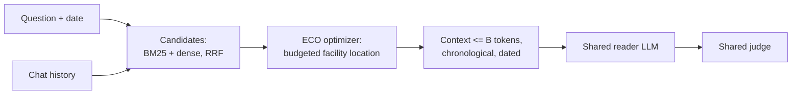

# ECO: context optimization under a token budget

Long-term chat assistants cannot put a user's whole history in the prompt. Given the history and a budget of
**B** tokens, a context optimizer decides what the reader model gets to see. This repo tests one idea,
**ECO**, against two recent memory systems, **ReFind** and **MemoryCPT**, and standard retrieval baselines on
[LongMemEval-S](https://github.com/xiaowu0162/LongMemEval). Every system gets the same reader, judge and
tokenizer, and the final context is asserted to be at most B tokens.

The result this repo is organized around is the first table under **Results**: one row per system, end to end. Every
other table is something smaller than the system — a proxy that makes no LLM calls, a granularity control, or one
objective mechanism switched on inside `eco_spans` — and is labelled as such.

## The idea

Top-k retrieval ranks and cuts: it fills the budget with the highest-scoring turns, and turns that score alike tend to
say alike things. (This was asserted here before it was measured; "The premise, measured" below does measure it, and
the honest version is that near-duplicate pairs are as common in the gold evidence as in top-k. What sentence-level
coverage demonstrably buys, on the evidence in the first Results table, is a context that answers the same questions
as the gold-evidence ceiling and as ordinary top-k / MMR over the same pool — with no LLM spend at either end. That is
a claim about what the budget is spent on, not a claim about beating retrieval, and it has not been shown to beat it.)
ECO treats context building as
**budgeted coverage**: choose the set of turns that best *covers* everything
relevant to the question, so each token of budget adds information the reader does not already have.

```
maximize   F(S) = sum over candidates i of  r(i) * max over m in S of  sim(i, m) * fid(m)
subject to sum over m in S of cost(m) <= B
```

- `r(i)`: relevance of turn i to the question: rank in the fused BM25 + dense (RRF) ranking, decayed as
  `exp(-(rank - 1) / tau)`
- `sim(i, m)`: how well chosen turn m stands in for turn i: embedding cosine, rescaled so that anything at or below a
  floor counts as no coverage
- `fid(m)`: fidelity of the rendering (1.0 for a raw turn, lower for a compressed fact)
- `cost(m)`: tokens

F is monotone submodular, so a lazy cost-benefit greedy (CELF) plus a best-single-item check gives a
constant-factor approximation guarantee.

The two shaping parameters matter. With the raw RRF score, relevance is nearly flat (the 40th-ranked turn still
weighs about 0.6 of the top one) and turns from the same chat all look similar, so the optimizer summarizes the whole
conversation instead of answering the question. That made ECO the weakest selector at small budgets. Both values,
`tau = 2` and `floor = 0.7`, were chosen on the dev split only (`scripts/sweep_eco.py`, rule fixed in advance: best
mean recall over the four budgets) and frozen before the test split was run.

## The flow



How the compared systems spend their effort:

| | ECO | ReFind (reimpl.) | MemoryCPT-lite (reimpl.) |
|---|---|---|---|
| Build time | index turns (no LLM) | none | LLM builds episodic + semantic memory |
| Query time | one optimization, no LLM | ReAct agent searches and takes notes | retrieval + LLM query-aware summary |
| Reader sees | raw turns chosen for coverage | collected notes, cut to B | summary (<= 512 tokens) |

## Results

### The whole system, end to end (dev, oracle view, one shared reader and judge)

Each row is a whole system: its own memory, its own way of spending the budget, then the same reader answering the
same question and the same judge marking it. Nothing here is a component ablation.

<!-- results:start -->
QA accuracy: 12 stratified dev questions, `oracle` view, one shared reader and judge (`gpt-oss-20b`), one token budget set in `configs/compare.yaml` (95% bootstrap CI). Source: `results/tables/20261022-133443_compare_dev_oracle_qa_summary.csv`. Every row is a whole system, end to end.

| System | Accuracy, B=500 | Reader context tokens (B=500) | LLM build tokens / question | LLM query-time tokens / query |
|---|---|---|---|---|
| **ECO (ours)** | 8/12 (0.33-0.92) | 480 | 0 | 0 |
| ReFind (reimpl.) | 4/12 (0.08-0.58) | 159 | 0 | 15,723 |
| MemoryCPT-lite (reimpl.) | 9/12 (0.50-1.00) | 109 | 7,585 | 1,570 |
| BM25 (turns) | 7/12 (0.33-0.83) | 472 | 0 | 0 |
| Hybrid BM25+dense (turns) | 7/12 (0.33-0.83) | 468 | 0 | 0 |
| MMR (turns) | 7/12 (0.33-0.83) | 454 | 0 | 0 |
| Hybrid BM25+dense (sentences) | 8/12 (0.42-0.92) | 479 | 0 | 0 |
| MMR (sentences) | 8/12 (0.42-0.92) | 480 | 0 | 0 |
| Oracle (upper bound) | 8/12 (0.33-0.92) | 466 | 0 | 0 |

Token columns count chat-model calls only (embeddings run locally and are listed separately in the CSV); judge calls are excluded from system cost. The oracle row is the ceiling this sample allows: the reader cannot answer questions whose evidence it would get wrong even with the gold sessions first.
<!-- results:end -->

How to read those twelve questions (this is a pilot, and the intervals say so):

- **The top row is MemoryCPT-lite (reimpl.), not ECO** — 9/12 against ECO's 8/12. Paired over the same questions that
  is −0.083 [−0.250, 0.000] and one discordant question, so exact McNemar gives p = 1.00: nothing is shown either way.
  What the row does show is the price: 7,585 construction + 1,570 query chat tokens per question, and a reader context
  of 109 tokens. ECO's row costs 0 chat tokens and fills 480 of the 500 it is given.
- **ECO is indistinguishable from the gold-evidence oracle and from both same-unit controls**: 0 discordant questions
  against `oracle`, `span_hybrid` and `span_mmr` — same answers, every question. Sentence-level selection buys a tie
  with the ceiling on this sample, not a lead.
- **Against turn-level retrieval** ECO is one question ahead (8/12 vs 7/12 for BM25, hybrid and MMR), one discordant
  question, p = 1.00.
- **Against ReFind** ECO is four questions ahead (8/12 vs 4/12), +0.333 [+0.083, +0.583] paired, and the only
  comparison with a direction — still p = 0.125 exact, so not significant at n = 12. ReFind spends 15,723 query chat
  tokens per question to hand the reader 159 tokens of context.
- **ReFind's row is an agent failure, not a retrieval one.** It saved at least one note on 5 of the 12 questions and
  answered 4 of those 5 correctly — 80% on the same reader, above ECO's 67% on all twelve. On the other 7 the agent
  wrote nothing down, so the reader got an 11-token context (the date header) and those are automatic zeros.
  `invalid_actions` is 0 on every question and `blank_replies` is 1, so the format is being followed; the model simply
  does not decide to save anything. Two bugs had to be fixed before this row could be read at all — the
  empty-completion transport bug and ReFind's own duplicated-observation and note-index flaws, recorded in
  `docs/reimplementation_notes.md`. This run has `errors.jsonl` empty and 12/12 jobs, where the pilot before it
  reported 0/12 with 11 tokens of context on *every* question.
- **The pre-registered rule is not met, and this table does not change that.** The rule was: beat both span-level
  controls at both B = 250 and B = 500 with the paired CI excluding zero. At Tier 1 the differences were
  +0.000/+0.005 and +0.011/0.000; here ECO and the span controls give literally the same answers. Twelve questions
  cannot resolve 8/12 from 7/12 — the next step for a claim about accuracy is n ≥ 100 on this reader, not a new
  mechanism.

### Evidence kept under a budget (test split)

<!-- recall:start -->
Test split, run once after ECO's settings were frozen on dev: 376 answerable questions, oracle view. Metric: share of gold evidence turns whose raw text reaches the reader (verbatim recall), with 95% bootstrap CIs. Source: `results/tables/20260930-080234_compare_test_oracle_recall_summary.csv`.

| System | B=250 | B=500 | B=1000 | B=2000 |
|---|---|---|---|---|
| **ECO (ours)** | 0.602 (0.56-0.64) | **0.809** (0.77-0.84) | **0.905** (0.88-0.93) | **0.954** (0.94-0.97) |
| Hybrid (BM25 + dense) | **0.632** (0.59-0.67) | 0.730 (0.69-0.77) | 0.832 (0.80-0.86) | 0.901 (0.88-0.92) |
| BM25 | 0.607 (0.56-0.65) | 0.729 (0.69-0.76) | 0.811 (0.78-0.84) | 0.873 (0.84-0.90) |
| MMR | 0.592 (0.55-0.63) | 0.727 (0.69-0.76) | 0.822 (0.79-0.85) | 0.892 (0.87-0.92) |
| Dense | 0.548 (0.51-0.59) | 0.673 (0.63-0.71) | 0.780 (0.75-0.81) | 0.860 (0.83-0.89) |
| Most recent | 0.102 (0.08-0.13) | 0.229 (0.19-0.27) | 0.357 (0.32-0.40) | 0.513 (0.47-0.55) |
| Oracle (upper bound) | 0.877 (0.85-0.90) | 0.977 (0.96-0.99) | 1.000 (1.00-1.00) | 1.000 (1.00-1.00) |

ECO minus the strongest baseline at each budget, paired over the same questions (95% paired bootstrap CI). Source: `results/tables/20260930-080234_compare_test_oracle_recall_paired_eco.csv`.

| Budget | Strongest baseline | Difference | 95% CI | ECO better / worse (questions) |
|---|---|---|---|---|
| 250 | Hybrid (BM25 + dense) | -0.031 | [-0.061, -0.002] | 25 / 42 |
| 500 | Hybrid (BM25 + dense) | +0.079 | [+0.045, +0.112] | 73 / 20 |
| 1000 | Hybrid (BM25 + dense) | +0.073 | [+0.047, +0.098] | 65 / 11 |
| 2000 | Hybrid (BM25 + dense) | +0.052 | [+0.035, +0.070] | 44 / 5 |

ECO minus the strongest baseline by question type (verbatim recall).

| Question type | n | B=250 | B=500 | B=1000 | B=2000 |
|---|---|---|---|---|---|
| knowledge-update | 57 | -0.132 | +0.088 | +0.026 | -0.009 |
| multi-session | 97 | -0.019 | +0.107 | +0.151 | +0.079 |
| single-session-assistant | 45 | -0.178 | -0.133 | -0.044 | +0.000 |
| single-session-preference | 24 | -0.042 | +0.000 | +0.014 | +0.021 |
| single-session-user | 51 | +0.000 | +0.039 | +0.000 | +0.000 |
| temporal-reasoning | 102 | +0.001 | +0.110 | +0.096 | +0.100 |
<!-- recall:end -->

**This table predates the BM25 idf fix** (run `20260930-080234`; see `docs/reimplementation_notes.md`). That fix
changes the ranking behind every row here except `recent`, so these numbers are no longer what the current code
produces. A rerun over the same 376 questions and budgets is in progress and will replace this block when it lands;
until then read the deltas below as the pre-fix record, not the current one.

What this shows:
- Once the budget fits a few turns (B >= 500), ECO keeps significantly more gold evidence than every retrieval
  baseline, with the largest gains on multi-session and temporal-reasoning questions, where evidence is spread over
  several turns.
- At B = 250, ECO is on par with BM25 and MMR and slightly behind hybrid retrieval.
- ECO is weakest on single-session-assistant questions, whose answer sits in one long assistant turn that the
  cost-per-token objective tends to skip.
- This measures what reaches the reader, not answer accuracy; it makes no LLM calls.

### Same budget, sentence granularity: what actually helps (dev, oracle view)

Verbatim turn recall cannot score a sentence-level selector — a sentence is never a whole turn — so two
granularity-neutral proxies were added (`core/eval/recall.py`, computed from logged contexts by
`scripts/score_traces.py`) and three span-level systems: `eco_spans` (the same facility location over sentence
spans), `span_hybrid` and `span_mmr` (the same pool, ordinary top-k / MMR). 94 answerable dev questions, 8 systems,
B in {128, 250, 500, 1000, 2000, 4000}, 752 jobs, 0 errors, no LLM calls.
Source: `results/tables/20261022-112348_compare_dev_oracle_recall_trace_metrics.csv`.

These numbers are **after** the BM25 idf fix described in `docs/reimplementation_notes.md` (rank_bm25 scores a term
that appears in exactly half the documents at idf 0, which blinded every BM25 user on small indexes — 42.6% of dev
oracle questions lost at least one keyword term). The same table before the fix is
`results/tables/20261022-082833_compare_dev_oracle_recall_trace_metrics.csv`, and the fix moved this repo's own
systems *down*: `eco_spans` answer_in_ctx 0.484 → 0.457 at B=250, turn-level ECO 0.372 → 0.367. Earlier published
runs are reproducible only by reverting that one file.

| System | answer_in_ctx B=250 | answer_in_ctx B=500 | content_recall B=250 | content_recall B=500 |
|---|---|---|---|---|
| ECO (turns) | 0.367 | 0.495 | 0.538 | 0.782 |
| BM25 | 0.431 | 0.484 | 0.599 | 0.754 |
| Hybrid | 0.362 | 0.473 | 0.541 | 0.742 |
| MMR | 0.372 | 0.495 | 0.531 | 0.729 |
| **ECO-spans** | 0.457 | 0.521 | 0.291 | 0.405 |
| span hybrid | 0.457 | 0.511 | 0.294 | 0.399 |
| span MMR | 0.452 | 0.521 | 0.291 | 0.410 |
| Oracle (turns) | 0.442 | 0.521 | 0.862 | 0.977 |

Paired over the same questions (95% bootstrap CI, 5000 resamples;
`results/tables/20261022-112348_compare_dev_oracle_recall_paired_eco_spans_trace_metrics_answer_in_ctx.csv`):
ECO-spans beats turn-level ECO by +0.090 [+0.011, +0.165] at B=250, beats turn-level hybrid by
+0.096 [+0.011, +0.176] and turn-level MMR by +0.085 [+0.011, +0.160]; against BM25 it is +0.027
[−0.037, +0.090], not significant. Against the two same-unit controls it is +0.000 [−0.032, +0.032] (span hybrid)
and +0.005 [−0.032, +0.043] (span MMR) at B=250, and +0.011 [0.000, +0.027] / +0.000 [−0.016, +0.016] at B=500.

What this shows, including the parts that do not help the story:
- **Granularity is the effect, the selector is not.** At sentence level the three selection rules are within noise of
  each other; the significant gain is turn-level → span-level, whichever rule you use. On this metric, at these
  budgets, facility location is not measurably better than top-k once the unit is a sentence.
- **Span granularity fixes the documented weak spot.** Turn-level ECO's worst category, single-session-assistant
  (answer inside one long assistant turn), goes 0.182 → 0.500 at B=250, and knowledge-update 0.533 → 0.800. Small
  cells (n = 11 and 15), so treat the direction as solid and the size as soft.
- **The two proxies disagree, and the reason is structural.** content_recall is *higher* for turn-level selection
  (0.538 vs 0.291 at B=250) because including one evidence turn credits every sentence in it — dev oracle views
  average 1.9 gold turns and 6.4 gold sentences per question, ~3.4 sentences per turn — so bulk inclusion is rewarded
  even though most of those sentences are filler. A span selector spends the same tokens on the handful of sentences
  it judges relevant and is scored down for the rest, yet still puts the answer string in front of the reader more
  often (0.457 vs 0.367 for ECO, +0.090 paired). A proxy that rewards dumping turns is the wrong thing to optimize;
  `answer_in_ctx` tracks the answer itself.
  Inverting the curves (`scripts/efficiency.py`,
  `results/tables/20261022-112348_compare_dev_oracle_recall_efficiency.csv`) says the same and, after the BM25 fix,
  does not flatter us: to reach verbatim_recall 0.8 BM25 needs 519 tokens, hybrid 624, ECO 655 — turn-level ECO is the
  *most* expensive of that group; and to reach content_recall 0.5 a span system needs ~986-1,014 tokens where a turn
  system needs 351-427.
- **`answer_in_ctx` has a ceiling** — the oracle scores 0.442 at B=250 and 0.569 at B=4000, because LongMemEval
  answers are often paraphrases, dates or counts that never appear verbatim. Compare systems to each other, not to 1.0.
- **Span ECO is tuned on its own terms, and the tuning is a tie.** `scripts/sweep_spans.py` sweeps rel_tau in
  {fused, 20, 10, 5, 2, 1} x sim_floor in {0.0, 0.5, 0.7, 0.85} on dev, rule fixed in advance (highest mean
  content_recall over the budgets; `results/tables/20261022-120213_eco_sweep_spans_dev.csv`, re-run after the BM25
  idf fix). Rank decay matters a lot — `tau = 2` scores 0.403 mean content while flat fused scores give 0.169-0.284 —
  but the floor does not, and after the idf fix the frozen pair is no longer the sweep's winner: the best cell is
  tau = 1 / floor = 0.0 at 0.407 mean content, 0.004 above the frozen tau = 2 / floor = 0.7 at 0.403, and the two are
  *identical* on `answer_in_ctx` (0.5071 each). A 0.004 gap on a 0.40 scale is the same noise the pre-fix sweep
  measured, so the frozen setting is kept rather than chased: switching to whichever cell tops a re-run of a sweep
  after a retrieval fix is exactly the tuning the protocol forbids. The sweep does re-derive the runner's numbers
  exactly at the frozen setting (content_recall 0.291 / 0.405 / 0.513 at B = 250 / 500 / 1000, the first two cells of
  the table above), which is the cross-check that the sweep and the runner compute the same thing.

### Appendix: the three selector mechanisms, component by component (dev, oracle view)

This is an ablation of **one component inside one system** — the objective `eco_spans` optimises — not a set of
competing systems. The rows below are variants of `eco_spans` with a flag switched on, and they are read only after the
whole-system comparison at the top of Results.

The section above says the interesting question is not the unit but the objective: if top-k, MMR and coverage all
pick the same five sentences, coverage is not the contribution. So three things a per-item score *cannot* express were
implemented behind flags in `systems/eco/objective.py` (each off by default, so `eco_spans` stays byte-identical to
the published run; `scripts/mechanisms.py` reports whether each one actually fired):

- **supersession** (`supersede=γ`): two spans that restate the same fact on different days are not interchangeable —
  coverage of the newer statement by the older one is discounted to γ, so leaving the current answer out costs real
  demand and greedy has to pay for it. `eco_sup`.
- **breadth**: the context should span several conversations. Hard form `one_per="session"` (`eco_clos`) makes it a
  set-level constraint; soft form `session_weight=w` (`eco_sess`, `eco_sess_x2`) adds one non-selectable demand row per
  session worth a share `w` of the total relevance mass, so spreading beats a small relevance margin but can still buy
  a second span of a rich session.
- **facets** (`facets=3`, `eco_facet`): the question's informative terms become extra demand rows, so one span that
  answers two parts of the question is cheaper than two spans answering one part each. `eco_full` / `eco_all` stack
  the three (hard / soft).

94 answerable dev questions, B in {250, 500, 1000}, 2 820 jobs, 0 errors, no LLM calls. `answer_in_ctx` (mean, and
paired against the two span-level retrieval baselines at B=250), source
`results/tables/20261022-123158_ablations_dev_oracle_recall_mechanisms.csv`, rerun after the BM25 idf fix; paired CIs
from `..._paired_<variant>_trace_metrics_answer_in_ctx.csv` (5 000 resamples, seed 0):

| System | B=250 | B=500 | B=1000 | tokens B=250 | spans B=250 | sessions in ctx / pool | paired vs span hybrid | paired vs span MMR |
|---|---|---|---|---|---|---|---|---|
| **eco_spans** | 0.457 | 0.521 | 0.543 | 236 | 5.99 | 1.72 / 1.91 | +0.000 [−0.032, +0.032] | +0.005 [−0.032, +0.043] |
| eco_sup | 0.457 | 0.521 | 0.543 | 236 | 5.99 | 1.73 / 1.91 | +0.000 [−0.032, +0.032] | +0.005 [−0.032, +0.043] |
| eco_sess (w=1) | 0.441 | 0.521 | 0.543 | 235 | 6.32 | 1.91 / 1.91 | −0.016 [−0.053, +0.021] | −0.011 [−0.053, +0.032] |
| eco_sess_x2 (w=2) | 0.431 | 0.511 | 0.543 | 235 | 6.45 | 1.91 / 1.91 | −0.027 [−0.074, +0.016] | −0.021 [−0.069, +0.027] |
| eco_facet | 0.436 | 0.521 | 0.543 | 236 | 6.18 | 1.74 / 1.91 | −0.021 [−0.048, 0.000] | −0.016 [−0.048, +0.016] |
| eco_all (soft stack) | 0.436 | 0.505 | 0.543 | 235 | 6.37 | 1.91 / 1.91 | −0.021 [−0.048, 0.000] | −0.016 [−0.048, +0.016] |
| eco_clos (hard) | 0.340 | 0.335 | 0.335 | **87** | 1.87 | 1.87 / 1.91 | −0.117 [−0.186, −0.053] | −0.112 [−0.175, −0.053] |
| eco_full (hard stack) | 0.282 | 0.277 | 0.277 | 82 | 1.89 | 1.89 / 1.91 | −0.175 [−0.250, −0.112] | −0.170 [−0.239, −0.106] |
| span hybrid | 0.457 | 0.511 | 0.543 | 236 | — | — | — | — |
| span MMR | 0.452 | 0.521 | 0.543 | 236 | — | — | — | — |

Read honestly, this is a negative result about the testbed, not about the mechanisms:

- **Supersession fires on every question and changes nothing.** It discounts 87.4 of the 100 candidate pairs on average
  (`superseded_pairs`), yet `eco_sup` picks the same sentences and the paired difference against `eco_spans` is exactly
  0.000 [0.000, 0.000] at all three budgets. In the oracle view the newest restatement is already the top-ranked span,
  so there is no stale-winner failure for the discount to fix.
- **Soft breadth does exactly what it claims and pays a little for it.** Sessions in the context go 1.72 → 1.91 (the
  whole pool), spans 5.99 → 6.32, tokens unchanged. `answer_in_ctx` drops 0.016 at B=250 (CI includes 0) and the
  dose–response is monotone in that direction (w=2 → −0.027), i.e. the knob bites, and what it buys is breadth rather
  than the answer string. At B≥500 it is a wash, and its `content_recall` (0.406 at B=500) is best among the ECO
  variants but still below span MMR's 0.410.
- **The hard cap is a budget bug, not a mechanism.** With 1.91 sessions in the pool, "at most one span per session"
  permits ~2 spans: 87 of 250 tokens are used and 163 are left unspent. `answer_in_ctx` 0.340 and `content_recall`
  0.165 — the loss is the unspent budget.
- **Facets cost relevance-mass, not much of it.** Adding query-term demand rows is −0.021 against span hybrid at
  B=250, but the CI's upper bound sits exactly on 0.000, so this run calls it a one-sided loss rather than a
  significant one; at B≥500 facets are indistinguishable from the flags-off variant.
- **The pre-registered rule is not met.** No variant beats *both* span_hybrid and span_mmr at *both* B=250 and B=500
  with the paired CI excluding zero (`eco_spans` itself: +0.000 / +0.005 at B=250, +0.011 [0.000, +0.027] / 0.000 at
  B=500), so this run does not license "ECO beats retrieval". It licenses the weaker sentence: at sentence granularity
  a set-level objective can be switched on without wrecking the context (soft breadth) or can wreck it (hard cap).
- **Why the oracle view cannot see any of this working.** `breadth_queries` = 0.63 and `sessions_in_pool` = 1.91:
  two thirds of these questions have a pool of fewer than two sessions, and supersession needs two dated restatements.
  The mechanisms were built for the failure modes of a ~115K-token haystack — stale earlier statements, evidence split
  across several sessions — which is the view where the search problem is real. A first full-view probe is running
  there (`compare.view=full`, 8 stratified dev questions, B in {250, 500}); its run id will be cited here when its
  table is in this repo, and until then no claim is made about what the mechanisms do.

### The premise, measured: is top-k actually redundant?

The method section says top-k "fills the budget with the highest-scoring turns, which are often near-duplicates of
each other". Nobody had measured it. `scripts/redundancy.py` strips the item headers from the contexts already in
`traces/`, re-embeds the item texts (largely cache hits; local CPU embeddings, no paid API) and reports pairwise
cosine similarity; `_redundancy.csv` is the table, `_paired_eco_redundancy_has_dup.csv` the paired test.

At B=250 every turn-level system selects ~3.1 items, so they are compared at equal count: mean pairwise cosine is
0.640 (BM25), 0.655 (hybrid), 0.620 (MMR), 0.636 (ECO), 0.641 (oracle); the share of pairs at or above ECO's own
similarity floor (0.7) is 0.336 / 0.384 / 0.269 / 0.338 / 0.346. ECO versus those baselines, paired per question:
+0.009 [−0.052, +0.067] against BM25, −0.039 [−0.091, +0.012] against hybrid, and **+0.078 [+0.009, +0.143] against
MMR — ECO is the more redundant of that pair**, not the less. From B = 1000 up, every context of every system,
including the oracle, contains at least one such pair (1.00), so the measure cannot separate selectors there.

So the premise as written does not hold at these budgets: near-duplicate pairs are a property of the *evidence*
(the same fact restated across sessions, which is why the gold-evidence oracle has them too), not a pathology top-k
introduces and coverage removes. The defensible claim is the one the numbers support: coverage helps when the unit is
small enough to leave filler out, and MMR-style penalisation is what actually changes duplicate counts. The duplicate
counters in `select()` remain the mechanism that keeps ECO from wasting budget on restatements, but this run does not
show them beating retrieval.

### Superseded: the first QA pilot (2026-09-30)

`results/tables/20260930-001519_compare_dev_oracle_qa_summary.csv` was the only Tier-2 run before the two fixes above:
12 questions, turn-level ECO only, and it reported ECO 7/12, MemoryCPT-lite 6/12, ReFind **0/12 with 11 tokens of
context on every question**. ReFind's row was not a result — it was the empty-completion bug plus its note-index flaw,
and the 11 tokens were just the date header. It is kept here because publishing the wrong number and then the fixed
one is the honest version of the record, and because it shows what an unvalidated transport looks like in a table.

## Systems

| Key | System | LLM calls |
|---|---|---|
| `recent` | most recent turns that fit | none |
| `bm25`, `dense`, `hybrid` | top-k by BM25, embeddings, or both fused with RRF | none (embeddings for dense/hybrid) |
| `mmr` | maximal marginal relevance, lambda 0.7 | none |
| `eco` | facility-location selection over raw turns (`systems/eco/select.py`) | none |
| `eco_spans` | the same optimizer over sentence spans, one item per claim (`systems/eco/spans.py`) | none (embeddings) |
| `eco_sup`, `eco_clos`, `eco_facet`, `eco_sess`, `eco_full`, `eco_all` | `eco_spans` with one or more set-level mechanisms on: supersession, hard breadth, facets, soft breadth (registry `SPAN_VARIANTS`; every mechanism is off by default) | none (embeddings) |
| `span_hybrid`, `span_mmr` | fused top-k / MMR over the same span pool — granularity controls for `eco_spans` | none (embeddings) |
| `eco_facts` | `eco` + LLM-extracted facts as retrieval keys and cheaper renderings | construction |
| `memorycpt` | MemoryCPT-lite (reimpl.): memory store + query-aware summary | construction + query |
| `refind` | ReFind (reimpl.): ReAct search agent that collects notes | query |
| `oracle` | gold evidence turns first (upper bound) | none |

Reimplementations are simplified: no released code or checkpoints exist for either paper. Every deviation from the
papers, and the measurement behind each one, is listed in `docs/reimplementation_notes.md`.

## Setup

Requires Python 3.11, [uv](https://docs.astral.sh/uv/) and [Ollama](https://ollama.com) for embeddings.

```bash
uv sync
cp .env.example .env                  # add your keys
ollama serve && ollama pull nomic-embed-text
```

For a CPU-only Ollama, export `OLLAMA_CONTEXT_LENGTH=8192 OLLAMA_NUM_PARALLEL=2` before `ollama serve`; the default
`n_ctx` of 2048 thrashes on the 64-text batches the index builders send (measured: 29-40 s per `/api/embed` request
before, ~2 s after) and Ollama's prompt cache makes a shared-prefix benchmark look 2x faster than it is.

Models are defined in `model.py` (`LLM_POOL`, `JUDGE_LLM`, `EMBEDDINGS`); every call goes through
`core.llm.client` with a SQLite cache (`.cache/`) and per-stage cost logging.

Data: download the cleaned LongMemEval files into `dataset/` (not committed), then freeze the split once:

```bash
uv run python scripts/prepare_data.py
```

### Google Colab

`scripts/colab_setup.sh` runs the four setup steps: pip deps, Ollama + `nomic-embed-text` (it picks up the T4), the
265 MB dataset download, and a credential check. What a GPU actually changes here is embedding throughput: the
full-haystack dev run embeds ~99K sentences, measured at 1,008 sentences/min on this sandbox's 4 CPU cores (≈90 min
per attempt), where the same pass on a T4 is minutes. It changes nothing about Tier 2 — reader and judge calls go to a
chat API, so `compare.eval=qa` still needs a real key in `.env` (`nvapi-…` / `sk-…`), and `model.py` assigns providers
by a hash of the question id unless one is pinned with `compare.pool_models=[openai/gpt-oss-20b]`. Running the reader
locally instead is possible but not comparable: gpt-oss-20b is ~13.5 GB and barely fits a 15 GB T4, and any smaller
local model is a different reader from the logged runs.

Two Colab-specific gotchas (the script checks the first one and prints the second):

- `configs/splits/longmemeval_s_split.json` records the dataset sha256 (`d6f21ea9…`) and `load_split` refuses a file
  that does not match, so the download must be byte-identical to `xiaowu0162/longmemeval-cleaned`.
- `.cache/` and `results/runs/` are written relative to the working directory, so run from the repo root; put the repo
  under `/content/drive/MyDrive/` and the SQLite cache survives a runtime restart. Free runtimes die at ~90 min idle
  or 12 h, but the cache and `predictions.jsonl` are incremental, so a rerun resumes instead of starting over.

## Run

```bash
# Tier 1: evidence recall per budget, no reader/judge calls (dev split, oracle view)
uv run python scripts/run_compare.py

# Tier 1 with sentence-granularity systems compared at the same budgets (the run behind the dev tables above)
uv run python scripts/run_compare.py "budgets=[128,250,500,1000,2000,4000]" \
  "compare.systems=[bm25,hybrid,mmr,eco,span_hybrid,span_mmr,eco_spans,oracle]"

# Mechanism ablation (the variants live in configs/ablations.yaml): rescore, then check what actually fired
uv run python scripts/run_compare.py config=ablations.yaml
uv run python scripts/score_traces.py results/runs/<run_id>
uv run python scripts/mechanisms.py  results/runs/<run_id>
uv run python scripts/paired_compare.py results/runs/<run_id> eco_spans answer_in_ctx trace_metrics.jsonl

# ... and the same variants where supersession and breadth have something to work on: the whole haystack
uv run python scripts/run_compare.py compare.view=full compare.n_questions=24 "budgets=[250,500]"

# Tier 2: the whole-system table at the top of Results — one budget, a stratified 12-question sample, the same
# reader and judge behind every row, and one hosted model pinned so no row gets a different engine
uv run python scripts/run_compare.py compare.eval=qa compare.n_questions=12 "budgets=[500]" \
  "compare.systems=[eco_spans,span_hybrid,span_mmr,bm25,hybrid,mmr,oracle,refind,memorycpt]" \
  compare.workers=4 "compare.pool_models=[openai/gpt-oss-20b]"

# ... and the two paired tests on it: bootstrap CI for size, exact McNemar for direction
uv run python scripts/paired_compare.py results/runs/<run_id> eco_spans correct
uv run python scripts/mcnemar.py results/runs/<run_id> eco_spans correct
```

Settings live in `configs/compare.yaml`; any field can be overridden as `a.b=value`. Every run writes
`results/runs/<run_id>/` (resolved config, git commit, predictions, costs, traces; not committed) and two tables:
`results/tables/<run_id>_summary.csv` (system x budget) and `results/tables/<run_id>.csv` (by question type,
with 95% bootstrap CIs). Tables are generated only from logged runs.

A new metric never requires a rerun, because the exact context string of every job is already in `traces/`:
`scripts/score_traces.py` rescores a logged run into `trace_metrics.jsonl` plus a `_trace_metrics.csv` table (and
`scripts/paired_compare.py <run> <system> <metric> trace_metrics.jsonl` pairs on it), `scripts/efficiency.py` inverts
the curves into "tokens needed to reach a target", and `scripts/redundancy.py` measures the selected contexts'
pairwise similarity, and `scripts/mechanisms.py` aggregates what each objective mechanism actually changed
(`superseded_pairs`, sessions in pool vs in context), which is how a null result is checked to be a real null rather
than a mechanism that never fired. `scripts/sweep_eco.py` and `scripts/sweep_spans.py` are dev-only tuning, and
`scripts/mcnemar.py <run> <system> <metric>` is the exact paired test on the same per-question values the bootstrap
in `paired_compare.py` resamples, because at 12 questions a CI that excludes zero and a p-value below 0.05 are not
the same claim.

## Evaluation protocol

- **Split:** 100 dev / 400 test, stratified by question type, frozen in `configs/splits/`. Everything is fit on
  dev; test is run once for the final report.
- **View:** `oracle` (evidence sessions only, median ~5.7K tokens) isolates selection from search; `full` uses
  the whole ~115K-token haystack.
- **Metrics:** `verbatim_recall` (share of gold evidence turns whose raw text reaches the reader),
  `evidence_recall` (also counts turns cited by a derived fact or summary), QA accuracy (LongMemEval judge
  prompt), and construction / query-time tokens per question (judge excluded). Two granularity-neutral proxies
  were added for span-level selection, both computed from the logged context, no LLM calls:
  `content_recall` (share of gold evidence *sentences* present verbatim; `core/eval/recall.py`) and
  `answer_in_ctx` (the gold answer string itself present: 1.0 exact phrase, 0.5 content words, 0.0 absent,
  `None` for abstention questions). They are proxies, not accuracy, and they disagree with each other — see the
  dev results below, so which one you optimize is a deliberate choice, not a free swap.
- **Decision rule, fixed before the runs:** ECO counts as beating retrieval only if it beats *both* same-unit controls
  (`span_hybrid`, `span_mmr`) at *both* B = 250 and B = 500 on `answer_in_ctx`, paired over the same questions, with the
  95% bootstrap CI excluding zero. Tier-2 accuracy is reported the same way plus an exact McNemar, and a Tier-1 null is
  not rescued by pointing at a small Tier-2 sample. Nothing in this repo currently meets the rule, and the tables say
  so.

## Repository layout

```
model.py            model definitions (keys come from .env)
configs/            base.yaml, compare.yaml, splits/
core/               shared plumbing: data + views, llm client/cache/cost, retrieval, eval, runner
systems/            one package per system: baselines/, eco/ (select.py the solver, objective.py the mechanisms,
                    spans.py the span-level system, method.py the turn-level one), refind/, memorycpt/
scripts/            run_compare.py, make_table.py, paired_compare.py, score_traces.py, efficiency.py,
                    redundancy.py, mechanisms.py, sweep_eco.py, sweep_spans.py, readme_results.py,
                    prepare_data.py, list_models.py
tests/              pytest suite (no network or paid LLM calls)
results/tables/     generated CSVs
```

Add a system: create `systems/<name>/`, implement `build_memory(q)` and
`build_context(query, memory, token_budget, query_date) -> ContextResult`, and register it in
`systems/__init__.py`.

## Tests

```bash
uv run pytest -q
```

## References

- LongMemEval: Wu et al., *Benchmarking Chat Assistants on Long-Term Interactive Memory*, 2024.
- ReFind: arXiv 2608.12888.
- MemoryCPT: arXiv 2608.04843.
